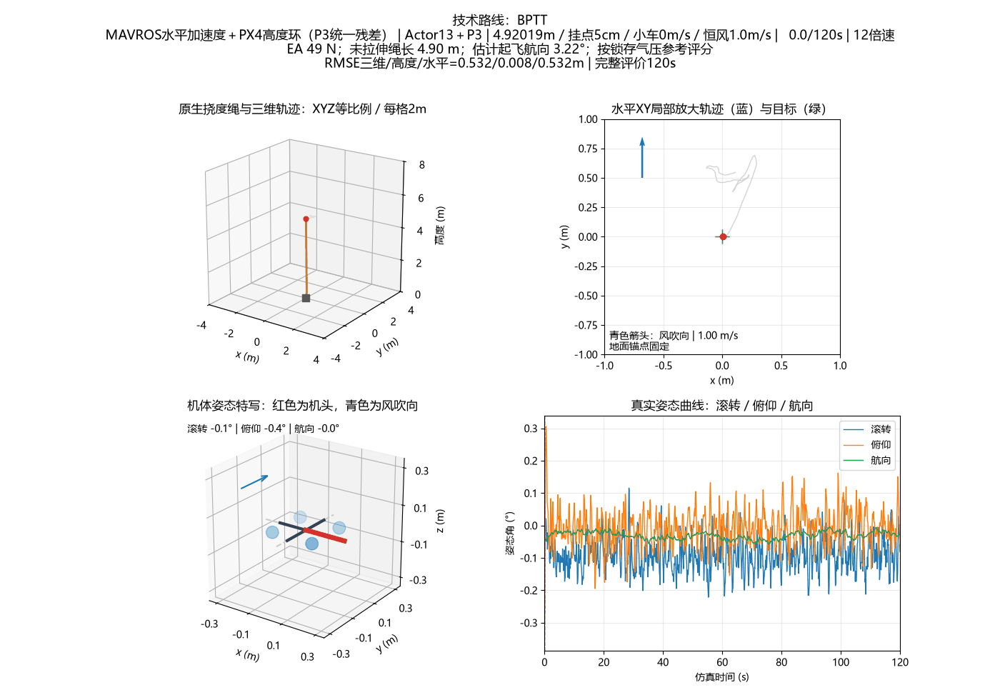
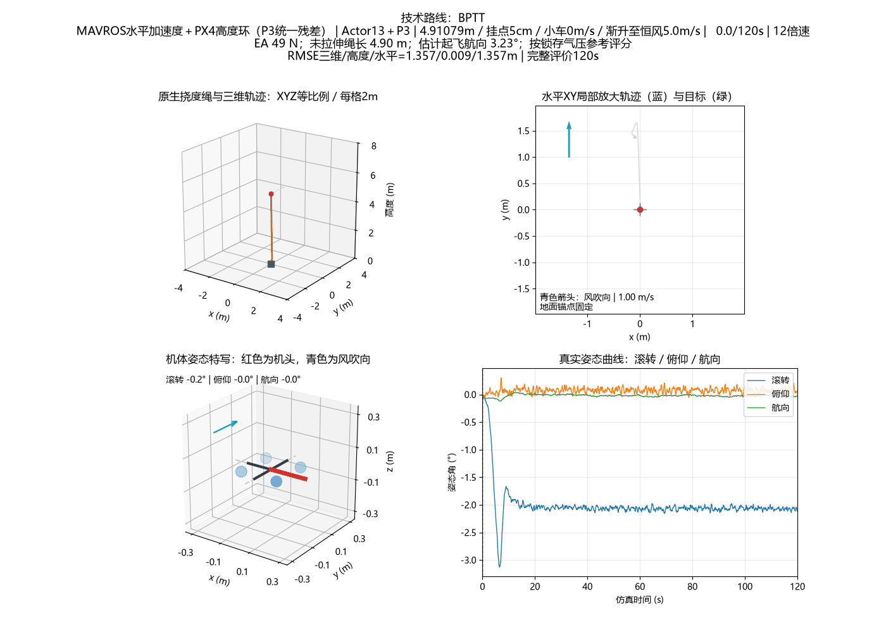

# Position统一残差P3

按用户要求，将加速度计读数误差、安装误差、偏载/质心等因素对观测与角运动的影响作为一个联合残差学习。每架飞机一个模型，一个联合损失与Adam。模型输出一个九维向量，包含三轴角速度读数修正、三轴比力读数修正、三轴等效自身角加速度残差；后三维乘P2标准惯量得到等效自身扰动力矩。模型直接学习观测差，参数中没有质心、安装角、实际质量或惯量的辨识结果。

训练条件为无环境风、无绳拉力的Position激励。真实PX4数据来自此前120s Position记录；三架安装倾斜/偏载飞机的数据来自原生MuJoCo的本地Position仿真控制器，非真实PX4采集。独立机体系位姿与位置仅用于训练监督。接管后使用IMU、PX4机体系姿态、实际RPM及执行油门。

原始时段先按67/33拆分，各段内生成位姿导数及参考比力；PX4记录在各分段内部对齐250Hz电机时钟。每机400步联合Adam，保留model.pt和Adam、训练来源、原始输入哈希、部署JSON与冻结源码。P2 Actor13及Adam保持原哈希。

| 飞机/数据 | 等效力矩残差最差单轴RMSE，补偿前→后 N·m | 比力最差单轴RMSE m/s² |
| --- | ---: | ---: |
| nominal_install | 0.212013 → 0.000105 | 0.027132 |
| light_install | 0.143771 → 0.000137 | 0.025987 |
| heavy_install | 0.332246 → 0.000153 | 0.026018 |
| px4_position | 0.000348 → 0.000244 | 0.051455 |

本表为独立Position时段上的自身残差预测误差，闭环位置RMSE另列。共享的传感器读数映射保持单位增益，风/绳造成的真实比力增量保留；角动力学预测使用前一时刻角速度，真实新角速度突变保留在P2创新中。

训练支持的输出幅度由训练分段等效力矩的99.9百分位乘1.25确定，各轴下限0.0001N·m，推理限幅采用这些Position数据得到的数值。当前PX4候选上限为[0.00325172,0.00093418,0.00036698]N·m。风/绳闭环数据没有参与该幅度估计或Adam更新。

闭环仍通过P3修正原有35维观测，再由冻结P2输出水平加速度。MAVROS发布水平加速度以及模式切入时锁存的高度、航向，PX4执行高度和姿态内环。当前姿态输入契约为PX4机体系FRD姿态。

新的真实PX4 Position记录可用以下入口训练，输出目录应新建。采集元数据必须记录零风、零绳力、Position且P2未接管。

```bash
python -B -m P3.unified_train CAPTURE/position.npz NEW_MODEL \
  --capture CAPTURE --controlled-external-loads
```

```bash
bash px4_offboard/launch_acceleration.sh --interface acceleration \
  --p3-calibration P3/results/unified_20261117/constrained/px4_position/bounded_observer.json
```

初版自由仿射读数映射出现信号增益塌缩，已弃用。增益修正后的无界角残差又在强风中外推过大，触发绳张力保护；对应完整120s计罚的三维/高度/水平RMSE为6.958/3.826/5.812m，实际10.212s。当前版本采用保持增益的映射及Position训练段输出约束，候选和来源严格区分。

当前bounded候选两组都安全完成120s，末段稳态2/2，逐例RMSE名义/工程容差均1/2。弱风0.532280m，比名义0.5m高3.228cm，比既定0.53m工程容差高2.280mm；保留未通过判定。

| 风 | 三维/高度/水平RMSE m | 安全时域 | 末段稳态 |
| --- | ---: | --- | --- |
| 1m/s | 0.532280 / 0.008145 / 0.532218 | 120/120s | True |
| 5m/s | 1.357480 / 0.009084 / 1.357450 | 120/120s | True |

弱风为1m/s恒风，强风前5s半余弦1→5m/s并保持，峰值5m/s，均沿工程+y。传感器种子2026114501/4503，5cm挂点，EA49N/4.90m有质量柔绳，XML机体2.369kg。P2标准仍2.3kg，MC_PITCHRATE_K=0.1沿用先前独立内环诊断。位置目标采用各次切入模式锁存参考，高度未写死为5m。

真实PX4与MAVROS完成输入/输出链路，最终发送水平加速度、锁存高度与航向。PX4继续有模拟GPS，Actor不读取水平位置/速度真值。两次独立异步启动，一风一种子，此为开发验证，正式独立留出及实飞未验收。三架非零安装/偏载飞机本轮只有Position留出，未新增其PX4闭环。

两份回放为12倍速，包含XYZ等比例、水平XY和姿态。

**统一P3→P2，加速度接口，1m/s**


**统一P3→P2，加速度接口，5m/s**


四模型/Adam、直接训练与部署源码快照保留在constrained各机目录。初版和无界试跑只保留[历史统计与源码](history/development.json)，清理见[逐文件清单](../../../cleanup/retention_unified_20261117.json)。270项回归269通过、1平台跳过；增益、外部冲量、Position条件及数据身份复核通过。当前无训练/仿真作业。

[四模型与完整留出统计](summary.json) · [当前核验](constrained/verification.json)
