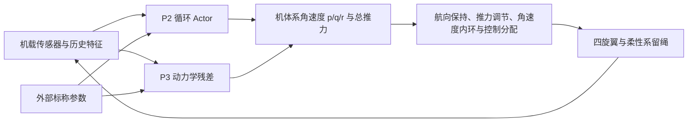

# Hover-BPTT · GNSS 拒止环境下的系留无人机控制

本工程研究四旋翼在无法使用 GNSS 定位时，如何仅凭机载感知，在柔性系留绳的约束下稳定悬停或跟随移动地面平台。控制策略由 PyTorch 中的可微动力学训练，随后在 MuJoCo 原生柔绳和 PX4 SITL 闭环中复验。

当前 5 m 开发路线使用 BPTT 训练三轴加速度输出。Actor 在起飞参考系中给出前向、右向和向下的期望加速度，固定可微执行层根据重力与期望加速度求期望推力方向，保持起飞航向，再按机载姿态与陀螺反馈生成力矩并分配至电机。BPTT 经过执行层和柔绳闭环。 [三轴加速度训练与验证入口](P2/README.md#三轴加速度开发) · [配对复验与回放](P2/results/acceleration/README.md)

[最新 PX4 高度零点复测](px4_offboard/stock_transfer/height_reference/README.md) · [P2 模型与 Adam](P2/models.json) · [P3 模型与 Adam](P3/models.json) · [移动平台复测](track/drift8/README.md)

## 场景与控制目标

- **固定锚点悬停。** 基准工况以起飞点为坐标原点，目标高度 5 m。测试包含弱风、强风、时变风和组合阵风。优先维持高度和稳定性，随后减小水平漂移。飞行器可以倾斜抗风，航向保持在设定参考，代表验证使用 0°。
- **移动锚点跟踪。** 地面绳端连接在小车上。8 m 详细验证从悬停起步，小车由静止平滑加速至 4 m/s。10 m 和 20 m 高度、4–6 m/s 的其他工况按历史统计保留。评价使用飞机相对小车的偏差，单独记录小车起步后的跟踪领先量。[8 m 对照](track/drift8/README.md) · [10/20 m 工况统计](track/reports/height_speed_statistics.md)
- **有挠度的柔性系留。** 物理模型使用 12 段绳和 11 个有质量节点，考虑松弛、受拉、阻尼和绳体风阻。机体连接点位于机体下方 5 cm 或 10 cm，拉力随几何和姿态改变，并在连接点产生力矩。5 m 基准的未拉伸绳长分别为 4.90 m 和 4.85 m，代表配置使用 49 N 轴向刚度参数 EA。[柔绳模型](mujoco_sim/README.md)

### GNSS 拒止的输入边界

| 用途 | 使用的信息 |
| --- | --- |
| 在线策略 | 35 维机载观测与历史特征，来自姿态、IMU、四路电机转速、上一周期电机指令、相对起飞点的气压高度和因果垂向速度，也包含由机载信号构造的运动与动力学残差特征 |
| 策略条件 | 14 维外部标称参数，包含机体与执行器配置。训练时实际动力学参数可在标称值周围变化 |
| 仿真和离线评价 | 仿真位置与速度、风场、绳形和张力用于物理求解、生成模拟传感器、训练损失和评估。Actor 的输入通道排除这些真值、GNSS 位置与小车轨迹 |

由惯性信号构造的运动特征会漂移，因此水平位置以仿真真值在离线评估。原厂 PX4 接管试验在切换前由 Position 使用仿真 GNSS 建立稳定悬停，Offboard 策略推理始终使用上述机载输入边界。另有关闭 GNSS 和视觉注入的 SITL 夹具验证。[PX4 运行方式](px4_offboard/README.md)

## 推力与角速度基线及 PX4 迁移



1. **P2 参数化 BPTT。** 将循环策略、控制接口、电机响应、刚体和柔绳在 PyTorch 中组成可微闭环，通过时间反向传播更新 Actor。训练中的位置损失优先约束高度，同时抑制水平漂移和大姿态运动。参数随机化覆盖质量 ±10%、三轴主惯量 ±15%、ESC 响应时间常数为标称值的 0.75–1.50 倍、转速增益 ±5%。Actor37 的最终训练采用 90 秒因果前置、末 30 秒梯度信用和 1 秒分段重算。默认 PX4 迁移另用 30 秒 BPTT 适配动作头，训练中近似 PX4 角速度内环、控制分配和电机响应。[P2 训练与配置](P2/README.md) · [默认 PX4 迁移](P2/results/px4_transfer/README.md)
2. **P3 模型误差补偿。** 冻结 P2 策略后采集短程柔绳轨迹，对同一状态和电机指令下的实际动力学与标称动力学作差，拟合质量、惯量、阻力和电机响应失配形成的残差。P3 使用机载历史、标称参数和电机命令，输出力、力矩及电机响应的补偿信息。在 PX4 Offboard 路径中，垂向力修正总推力，力矩通过等效角速度偏置接入。P3 在闭环对照中冻结权重，可单独启停。[P3 训练与配对验证](P3/README.md)
3. **逐级验证。** 先在可微模型检查梯度、闭环稳定性及候选参数，再冻结权重进入原生 MuJoCo。PX4 SITL 使用飞控二进制和 MAVLink 机载遥测闭环，审计解锁、模式切换、命令间隔、姿态、张力和完整评价时域。结果分列三维、高度及水平 RMSE，报告风型、时域、传感器种子和策略版本。提前失效的试验按对应协议对余下时段计罚。[MuJoCo 验证](mujoco_sim/README.md) · [PX4 验证](px4_offboard/stock_transfer/README.md)

## PX4 实施

- **起飞点零点。** 在地面未解锁、着地时订阅 `ALTITUDE`（141）与 `EXTENDED_SYS_STATE`（245），采集校准气压高度 `ALTITUDE.altitude_monotonic`，以地面样本中位数建立零点。策略使用当前气压高度减去该零点，空中接管沿用起飞前的基准。训练的高度目标采用同一坐标定义。
- **接管与内环。** Offboard 通过 `SET_ATTITUDE_TARGET` 发送机体系角速度和总推力。原厂 PX4 1.14.4 多旋翼配置负责角速度闭环和电机分配，适配器按该配置转换推力信号并平滑接管。MuJoCo 提供柔绳、飞行器和执行器动力学，电机响应为仿真配置。实机固件、ESC 遥测与接管仍需对应硬件验证。[接口、订阅与运行配置](px4_offboard/README.md) · [原厂内环接管记录](px4_offboard/stock_transfer/README.md)

## 开发结果与权重

| 工况 | 完整时域与安全完成 | 三维／高度／水平 RMSE（m） |
| --- | --- | ---: |
| [5 m 原生 MuJoCo 三轴加速度，BPTT 两次更新](P2/results/acceleration/README.md) | 120 秒，8/8 | 0.744 / 0.081 / 0.739 |
| [5 m 原生 MuJoCo 恒风，Actor37](P2/results/stationarity/FINAL37.md) | 120 秒，32/32 | 0.657 / 0.113 / 0.647 |
| [5 m 原生 MuJoCo 时变与组合风，Actor37](P2/results/time_varying37/README.md) | 120 秒，32/32 | 0.604 / 0.132 / 0.590 |
| [8 m 原生 MuJoCo 悬停与跟踪，Actor31＋P3](track/drift8/README.md) | 120 秒，6/6 | 1.327 / 0.100 / 1.323 |
| [5 m 默认 PX4 高度零点复测，Actor38，1013.25 / 1036.50 hPa](px4_offboard/stock_transfer/height_reference/README.md) | 15 秒，2/2 | 0.619 / 0.075 / 0.614<br>0.617 / 0.064 / 0.613 |

MuJoCo 行按各组汇总，最后一行列出两条 1 m/s 恒风单例，传感器种子为 `21685134`。两组气压复测使用相同策略，1036.50 hPa 工况的高度输入相对仿真真值 RMSE 为 0.96 cm。表中记录属于开发验证，留出最终验收和实飞验收独立进行。 [最后一组回放](px4_offboard/stock_transfer/height_reference/site1036/replay/flight.gif) · [历史接管与强弱风统计](px4_offboard/stock_transfer/history_statistics.json)

| 检查点 | 用途 |
| --- | --- |
| [P2 三轴加速度，BPTT 两次更新](P2/results/acceleration/training_transfer/latest.pt) | 当前 5 m 加速度开发策略 |
| [P2 Actor37](P2/results/stationarity/selected37/latest.pt) | 5 m 常规 P2 基线 |
| [P2 Actor38](P2/results/px4_transfer/update2/candidate.pt) | 选定的默认 PX4 迁移权重，用于最后一组复测 |
| [P2 Actor39](P2/results/px4_transfer/update3/candidate.pt) | 最近训练产物，开发复测出现保护触发，作为未入选候选归档 |
| [P3 5 m 配套残差](P3/results/actor37_5m/residual/best.pt) | 基于 Actor37 拟合，用于 P3 开关对照 |
| [Actor31](track/drift8/step2/latest.pt) 与 [P3 8 m 残差](P3/retest8/residual/best.pt) | 8 m 悬停与移动锚点验证 |

各检查点包含对应 Adam 状态。其他保留模型、适用配置和 SHA256 见 [P2 索引](P2/models.json)与 [P3 索引](P3/models.json)。

## 工程入口与复现

| 目录 | 内容 |
| --- | --- |
| [P2](P2/README.md) | 可微物理、机载观测、循环 Actor、参数随机化、预检和 BPTT |
| [P3](P3/README.md) | 残差采集、拟合、验证和补偿 |
| [mujoco_sim](mujoco_sim/README.md) | 原生柔绳模型与数值回归 |
| [track](track/README.md) | 移动锚点场景、跟踪评价、阶段权重和回放 |
| [px4_offboard](px4_offboard/README.md) | 独立的 PX4 SITL 接口、运行资产和闭环审计 |
| [stable_retest](stable_retest/README.md) | 稳定版配置与历史对照 |
| [cleanup](cleanup/README.md) | 工程清单、保留记录和完整性核验 |

Windows 验证环境使用 Python 3.11，核心依赖版本见 [requirements.txt](requirements.txt)。`python.cmd` 调用同级共享 `training_env`。使用其他环境时可从工程根目录改用对应的 Python 解释器。以下命令核对工程并运行回归测试。

```powershell
.\python.cmd -B verify_project.py --strict-sources
.\python.cmd -B -m unittest discover -s . -t .
```

在已有 PX4 SITL、MuJoCo 和 pymavlink 的 Linux 仿真环境，可用归档资产复跑最近的 1036.50 hPa 工况。入口要求新的输出目录。

```bash
python -B px4_offboard/stock_transfer/stock_check_hold.py new_run \
  --assets px4_offboard/stock_transfer/selected_assets --motor-tau .045 \
  --seconds 15 --wind 1 --sensor-seed 21685134 --site-pressure-hpa 1036.5 --no-residual
```
