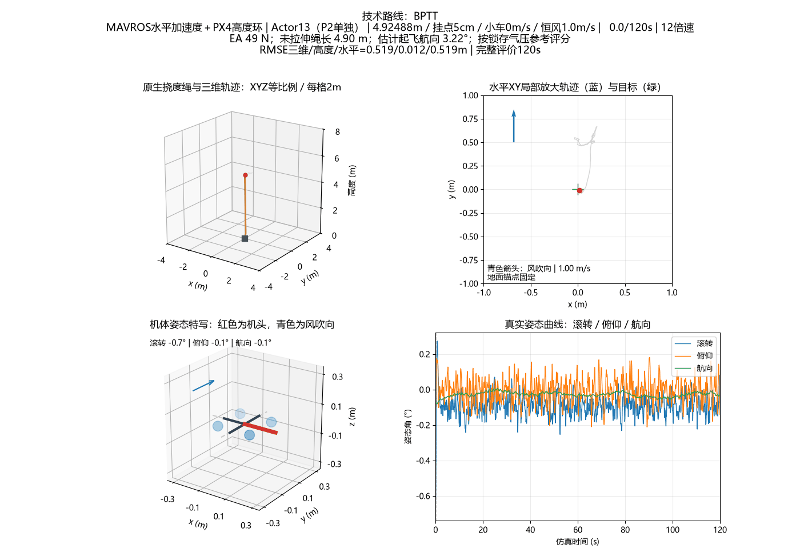
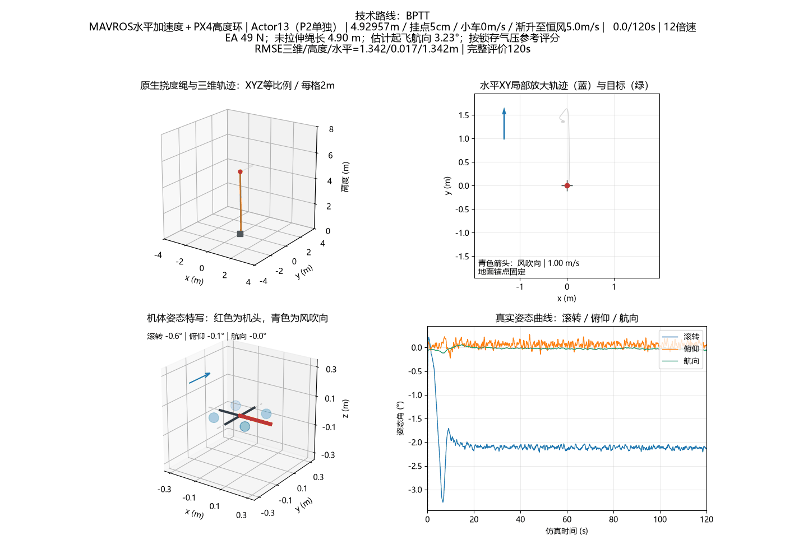
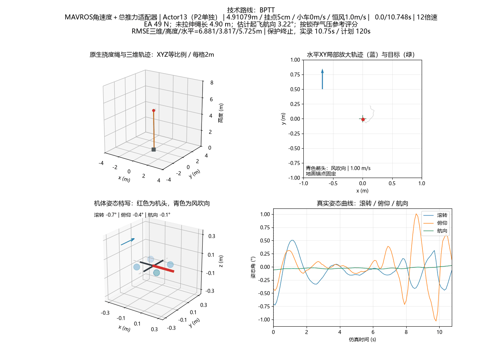
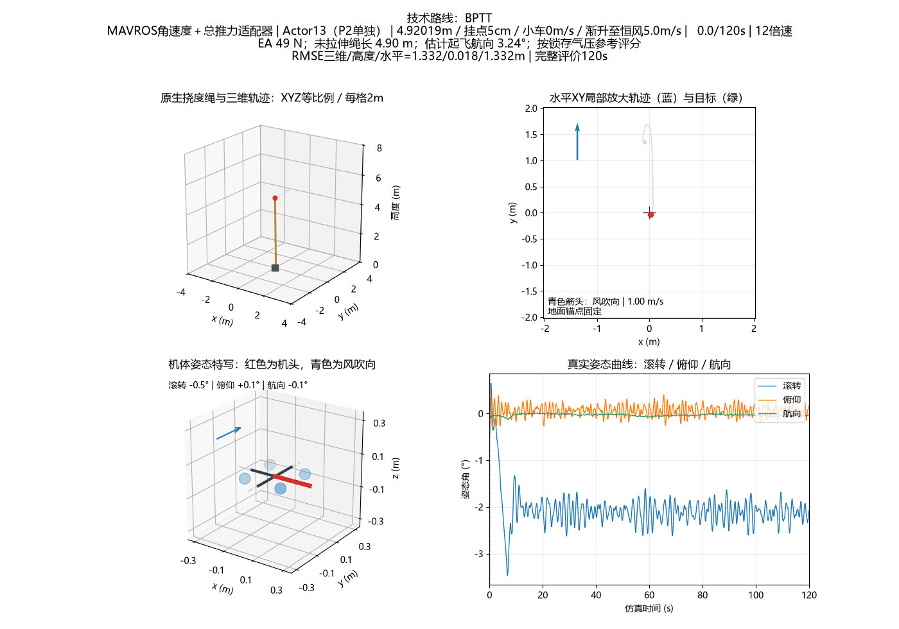

# PX4内环诊断与P3先行（2026-11-16）

上一轮差的关键原因已经由独立Position试验定位：在P2不工作、无风无绳时，stock Iris内环即有俯仰角速度RMS2.3805rad/s和75%电机饱和。仅将运行内MC_PITCHRATE_K从1缩放至0.1，短测RMS约0.0022rad/s、饱和0；120s三轴Position激励也0饱和。不能用这种内环失配下的差成绩证明Actor本身训练不足，也不能指望P3补偿替代稳定的基础内环。

原训练执行层为机载姿态/陀螺到物理力矩再到电机的可微闭环；PX4迁移换成了stock Iris角速度PID/分配器，并增加65ms因果命令平滑，没有针对这一完整执行链重新训练。因此导出的网络数值一致，并不保证闭环动力学一致。旧结果中大部分时刻任一电机到0/1边界；在饱和下集体推力与姿态力矩互相约束，高度控制难以保持。

另有元数据错误：config.actual声明2.3kg/J标准值，XML真正求解2.369kg/J高2%。旧报告“实际标称2.3kg”的表述不准确。保留原数据和原XML，P2参考仍2.3kg；新Position辨识独立得到2.36910kg。

按用户纠正的顺序，已经完成真实PX4 Position120s采集和P3拟合，P2全程未接管。[P3数据、参数与留出](../../P3/results/px4_position_20261116/README.md)。完整P3飞控内力矩补偿尚未接入。

## 匹配内环后的P2基线（P3仍关闭）

| 接口/风 | 实录/计划s | 三维/高度/水平RMSE m | 安全 | 稳态 |
| --- | ---: | ---: | --- | --- |
| acceleration/1m/s | 120.000/120 | 0.519/0.012/0.519 | True | True |
| rate_thrust/1m/s | 10.748/120 | 6.881/3.817/5.725 | False | False |
| acceleration/5m/s | 120.000/120 | 1.342/0.017/1.342 | True | True |
| rate_thrust/5m/s | 120.000/120 | 1.332/0.018/1.332 | True | True |

弱风加速度0.519m比名义0.5m超0.019m，在既定绝对3cm工程容差内；强风两例低于1.5m。角速度+推力的弱风在10.748s因绳峰值张力33.48N保护终止，余下120s时域计罚。该例需继续核对其本地垂向执行层与滤波，不能把问题都归给P3。

新四例使用原Actor13，种子2026114501/4503，5cm挂点、相同XML和资产。弱风1m/s恒风，强风接管后5s半余弦1→5m/s。PX4仍用模拟GPS；Actor无水平导航真值。参考各自入模锁存高度，独立异步启动初态不逐位相同。新节点已直接记录其内部气压目标；旧录像的夹具心跳目标统计单独保留。因此新旧总体比较不冒称所有条件完全逐位配对。

## 当前P2回放（12倍速）

## 后续验证与保留边界

用户随后明确选择P3标准化现有观测、冻结P2并输出加速度。该链路已完成四例120s，完整结果和回放见[observer_report.md](observer_report.md)。没有新增显式力矩消息，PX4反馈内环承担物理扰动拒斥，不把观测补偿冒称原生分配前完整力矩前馈。

2026-11-16整理后，上述15s内环预检和更早接口调试只保留[历史统计及源码](history/development_20261116.json)。本页full_03同内环P2四例原始轨迹、ULog、审计和动图完整保留，最新full_05也完整保留。
