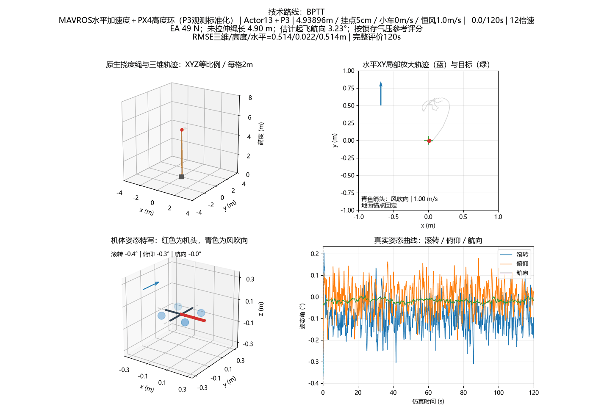
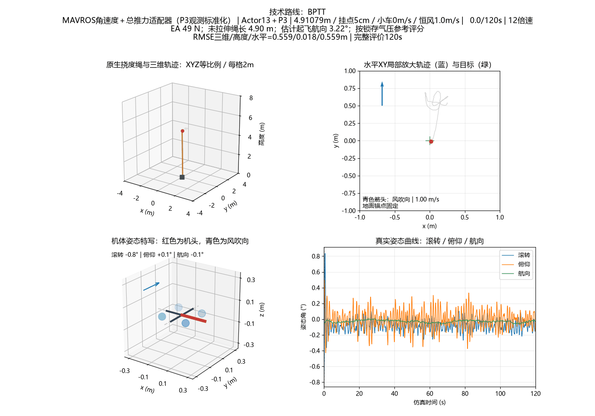
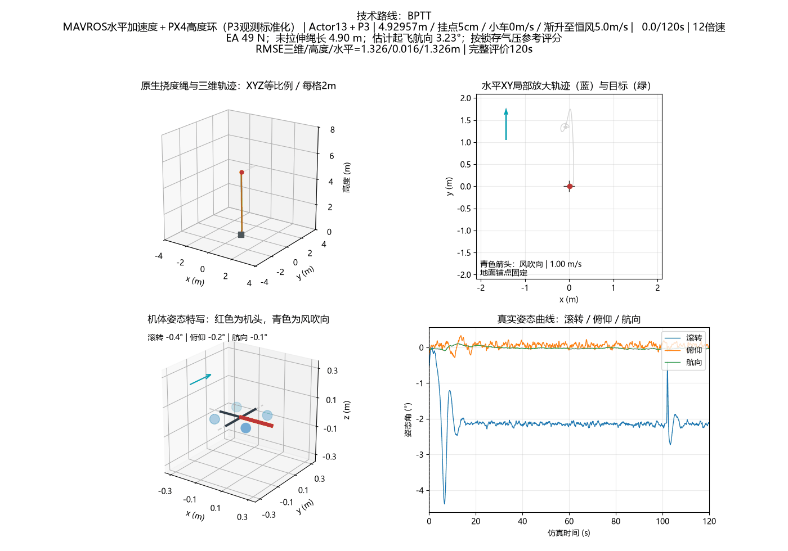
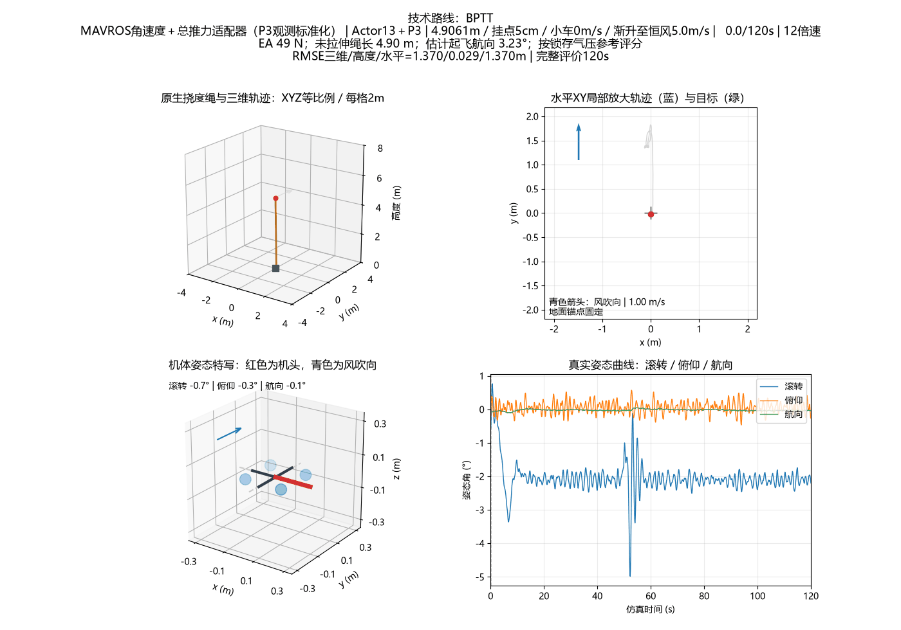

# P3观测补偿与冻结P2：120秒结果

P2作为固定标准机体策略，Actor13及Adam不更新。P3在Position中辨识自身参数，运行时校正IMU、运输到质心，并修正角运动预测；沿用35维观测和14维标称上下文，P2输出加速度。没有把P3动作与P2动作直接相加，也没有新增P2输入维度。

当前P3为物理参数辨识加因果历史状态，承担时序适配作用；不是已经实现或训练好的GRU网络。若后续使用GRU，新增网络和学习放在P3内，不要求改P2权重。

四例均安全完成120s，强风两例通过RMSE和稳态；弱风两例仍缓慢漂移，不能宣称已稳定收敛或通用性能已验收。

| P2+P3输出接口 | 风 | 三维／高度／水平RMSE m | 安全 | 名义RMSE | 工程容差RMSE | 稳态 |
| --- | --- | ---: | --- | --- | --- | --- |
| 水平加速度＋PX4高度环 | 1m/s | 0.514 / 0.022 / 0.514 | True | False | True | False |
| 角速度＋总推力适配器 | 1m/s | 0.559 / 0.018 / 0.559 | True | False | False | False |
| 水平加速度＋PX4高度环 | 5m/s | 1.326 / 0.016 / 1.326 | True | True | True | True |
| 角速度＋总推力适配器 | 5m/s | 1.370 / 0.029 / 1.370 | True | True | True | True |

弱风名义0.5m、允许绝对3cm工程容差；强风1.5m。弱风加速度高0.014m，在容差内；角速度＋推力0.559m超过0.53m。末30s水平漂移分别约0.01130/0.01312m/s，高于0.01m/s稳态门限；不能因RMSE较小就说已经收敛。

## P3怎样融入

先校正传感器安装旋转、零偏及姿态参考，因果gyro差分得到角加速度并把IMU运输到CG；滤波与比力保持一致。由辨识质量和机载比力计算CG参考点运输力矩；按实测样本时间积分自身动力学影响，修正现有角运动创新，并归一至P2标称10ms步长。剩余创新仍包含风、绳、其他模型误差和噪声，不是绳力矩真值。

加速度路线经实际MAVROS发送84号SET_POSITION_TARGET_LOCAL_NED，mask2363，仅水平加速度、模式切入锁存本地z和航向有效；PX4执行高度、姿态和内环。保留路线将同一P2加速度转成推力/角速度，最后按C^T V转回PX4报告机体系，再发送82号SET_ATTITUDE_TARGET、mask128。它们都接同一个P3前端；都没有额外力矩消息。

## 当前四份动图

首行技术路线BPTT，12倍速、XYZ等比例，包含三维、XY与姿态。以下全为full_05最终维护版，不用旧full_04较好单例替代。

**acceleration／1m/s**


**rate_thrust／1m/s**


**acceleration／5m/s**


**rate_thrust／5m/s**


## 同内环P2基线与边界

| 接口／风 | P2基线三维RMSE m | P2基线安全／稳态 | P2+P3三维RMSE m |
| --- | ---: | --- | ---: |
| acceleration／1 | 0.519 | True／True | 0.514 |
| rate_thrust／1 | 6.881 | False／False | 0.559 |
| acceleration／5 | 1.342 | True／True | 1.326 |
| rate_thrust／5 | 1.332 | True／True | 1.370 |

每工况独立启动PX4，初态不逐位一致，不能把单种子差异全部归因于P3。先做Position再冻结校准；这架XML机体的CG和额外安装倾斜接近零，因此本组主要验证接入与输入边界，不证明对大偏载/安装误差的泛化。已有原生三机偏载P3证据保持独立。

当前VM只有1个可用CPU核，本组飞行顺序运行，四份离线回放并行生成。观测到推理节拍约acceleration/1:81.8Hz, rate_thrust/1:99.0Hz, acceleration/5:49.5Hz, rate_thrust/5:99.0Hz；其他冻结运动历史仍使用标称10ms，未证明采样频率不变性。该时序差异与弱风漂移的因果关系尚未隔离，不能把所有残差都解释成机体误差。

风沿+y；弱风1m/s恒定，强风在接管后5s半余弦1→5m/s，此后5m/s，峰值5m/s。传感器种子2026114501/4503，挂点5cm，EA49N/4.90m有质量绳，实际XML2.369kg，P2标称2.3kg；本轮明确MC_PITCHRATE_K=0.1。PX4仍使用模拟GPS，Actor不使用水平导航真值。没有正式独立留出或实飞验收。

Actor SHA256 `4743e4e7d40f26c2e3baea8ad8a6ee94bc14c2710838c9fd94235211abdb1ab5`；P3 SHA256 `c565414fd64e8803b15c7bdbb30b6b99ac9969ee1f76d16b71c01877fa177ae7`。P3参数/Adam、Position数据和时段留出见[P3报告](../../P3/results/px4_position_20261116/README.md)。完整原始数据、ULog、实际线缆字节、机载诊断和冻结源码随各例保存。运行统计见[observer_summary.json](observer_summary.json)。

## 一键复现

在既有VM任务目录执行（新输出目录）：

```bash
bash px4_offboard/run_dual_suite.sh results/new_P3_observer mavros .1 px4_offboard/acceleration_dual/p3_observer.json
# 只运行机载加速度入口，使用已有MAVROS；不自动解锁或切换模式
bash px4_offboard/launch_acceleration.sh --interface acceleration --p3-calibration px4_offboard/acceleration_dual/p3_observer.json
```

本地导出物理校准JSON用P3.export_px4_observer；运行只需NumPy，不向VM安装Torch。原始P2/P3历史模型与入口保留。
